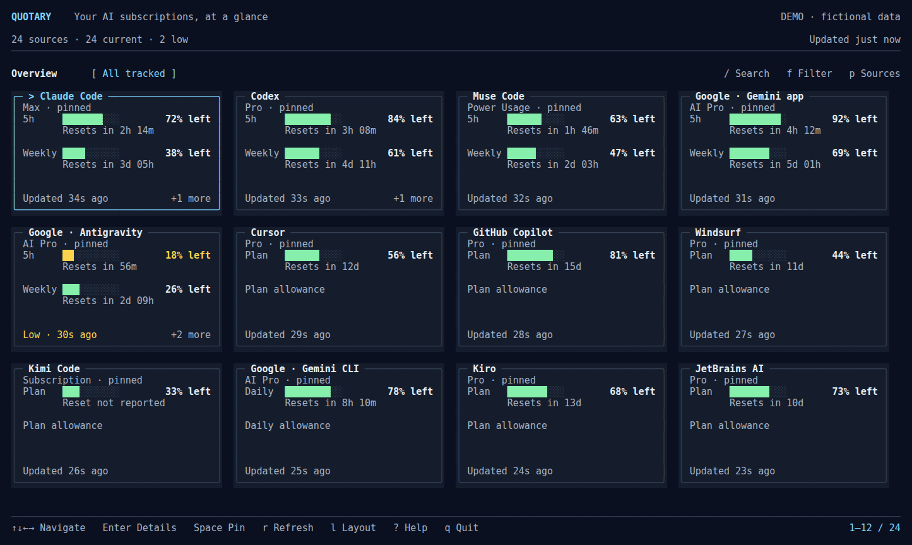

# Quotary

**Your AI subscriptions, at a glance.**

Quotary is a planned Go terminal dashboard for seeing the capacity, reset times,
plans, and usage history of the AI services you use. Its first prototype is
designed around CodexBar CLI: CodexBar reads provider data, and Quotary turns it
into a polished, keyboard driven interface.



*Fictional design reference. No application or provider reading is shown here.*

**Project status:** specifications and visual mockups are ready; the Go
application has not been implemented. The commands and behavior in the specs are
design targets, not working application features.

## Preview the design

Open [`docs/mockups/index.html`](docs/mockups/index.html) in a browser. The
interactive reference works locally without an account, backend, server, or
network connection. Choose a view, terminal size, or theme using the controls
above the terminal, then click the terminal and try its keyboard controls.

See the [mockup implementer guide](docs/mockups/README.md) for the screen index,
cell measurements, interactions, fictional fixtures, and instructions to export
the reference screenshots again.

## Product goals

- Make the large collection the normal case. Discover the complete provider
  catalog exposed by the backend rather than capping the view at four services.
- Give Claude Code, Codex, Muse Code, Gemini, and Antigravity explicit
  validation coverage, while keeping other compatible subscriptions discoverable.
- Show each source's reported allowance, units, and reset. Keep stale, missing,
  and genuinely exhausted readings distinct; do not combine unrelated quotas
  into a fictitious overall percentage.
- Include an attractive offline demonstration using clearly fictional data.
- Start with Linux and keep provider reading behind a Go adapter that can be
  checked independently from the terminal presentation.

Google's Gemini app, Gemini CLI, and Antigravity are separate sources. API usage,
credits, token history, and subscription allowances also remain distinct. The
backend catalog snapshot contains 106 provider IDs; it is a catalog reference,
not proof of 106 active subscriptions or working integrations.

## Project documents

- [Product and technical specification](SPEC.md): scope, coverage, backend
  contract, data meaning, implementation stages, and acceptance criteria.
- [Visual and interaction specification](UX.md): layouts, keyboard behavior,
  states, themes, and small terminal requirements.
- [Interactive mockups](docs/mockups/index.html) and [implementer guide](docs/mockups/README.md):
  15 reference screens, browser preview, fixtures, and reproducible captures.
- [CodexBar 0.77.0 provider catalog](docs/reference/codexbar-0.77.0-providers.json):
  public default catalog metadata captured from an empty temporary configuration.

## Backend reference

The prototype references [CodexBar CLI v0.77.0](https://github.com/steipete/CodexBar/releases/tag/v0.77.0).
Its executable is named `codexbar`. The mockups do not invoke it or read local
provider credentials. The disposable copy previously used to inspect its public
catalog lived at `/tmp/codexbar-cli/`; temporary development files may be removed
and are not a runtime dependency.

The Go application is intended to accept a configured executable path, then
discover `codexbar` on `PATH`. Keep CodexBar's executable and resource bundle
together when installing it. Refer to the
[upstream CLI documentation](https://github.com/steipete/CodexBar/blob/v0.77.0/docs/cli.md)
for its setup and provider behavior.

## Repository contents

```text
README.md                         Project overview and preview instructions
SPEC.md                           Product and technical specification
UX.md                             TUI and interaction specification
docs/mockups/                     Offline browser reference and screenshots
docs/reference/                   Pinned public provider catalog snapshot
```

There is no Go module, executable, or live integration in this repository yet.
Implementation and product acceptance remain open work in `SPEC.md` and `UX.md`.

## License

Quotary's repository content is provided under the [MIT License](LICENSE).
CodexBar is a separate upstream project; its name and referenced behavior remain
subject to its own license and terms.
