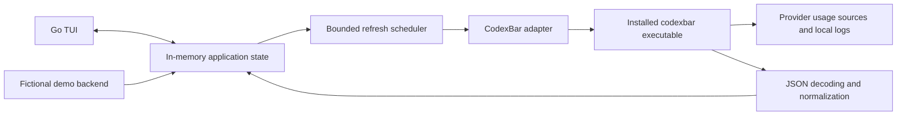

# Quotary — product and technical specification

Status: proposed prototype; no application implementation or live account validation.
Date: 2026-10-16.
Visual contract: [tui.md](tui.md).

## 1. Product

Quotary is a Go TUI for seeing the available capacity across a person's AI
subscriptions. Its first screen answers: **What can I use, how much is left, and
when does it reset?** A selected service reveals its additional allowances,
account and plan information, and supported local usage history.

The name **Quotary** was selected by the user. The executable and repository name
are `quotary`; the tagline is **Your AI subscriptions, at a glance.**

The main quality targets are visual polish and broad subscription coverage.
Design for someone who subscribes to many supported services. Claude Code,
Codex, Muse Code, and Google are priority validation cases, not a four-provider
limit. The overview must remain attractive and navigable with dozens of sources.

The prototype uses **CodexBar CLI**, whose executable is `codexbar`. References
to “codexcli-bar” in the initial request mean this dependency. The Go application
does not require porting CodexBar's Swift implementation.

## 2. Scope and boundaries

### Required for the prototype

- Dynamically discover the installed backend's full provider catalog.
- Render reported quota windows, remaining percentages, resets, plans, credits,
  and additional details through a shared presentation model.
- Provide an adaptive card overview, a compact overview, provider details, search,
  filtering, source selection, refresh controls, and a discoverable help screen.
- Make large subscription collections a normal case. Provide bulk tracking and
  progress that remains useful while a large collection loads.
- Include on-demand local token/history views where the backend supports them.
- Show clear missing-authentication, unavailable, stale, partial, and unsupported
  states without discarding successful readings from other services.
- Deliver a rich, deterministic offline demo, including a broad subscription
  collection and a stress collection based on the full catalog.
- Support Linux first, including this Ubuntu machine. Keep domain and UI code
  portable; macOS acceptance is separate. Windows is a later milestone.

### Deferred

Native Go provider collectors; credential entry or account login flows inside the
TUI; managing billing or subscriptions; starting agents or sending model prompts;
desktop notifications; a background service; remote hosting; persistent quota
sampling; transcript browsing; exports; and a plugin authoring API.

Viewing multiple records returned by the backend is in scope. Creating accounts,
changing a provider CLI's active account, and comprehensive multi-account
management are deferred.

## 3. Coverage model

### Discover broadly, describe precisely

Run `codexbar config providers --format json` to obtain the catalog. Version
0.77.0 reports **106 provider IDs** in an empty configuration. The captured
[reference catalog](../reference/codexbar-0.77.0-providers.json) is evidence of
that baseline, not a permanent enumeration or evidence of working logins.

The catalog command reports IDs, names, and enablement. It does **not** establish
authentication, entitlement, supported metrics, or successful usage collection.
Keep these concepts distinct:

| Concept | Meaning |
| --- | --- |
| Available in backend | The installed catalog contains the provider. |
| Tracked in Quotary | The user chose to include this source in the overview. |
| Readable | A refresh returned valid data for this account/source. |
| Fixture covered | The adapter and UI handle a known response shape. |
| Live verified | A recorded manual check returned real data for that source. |

Catalog entries can describe subscriptions, prepaid credits, API billing, local
history, or mixed offerings. Show those distinctions. A balance-only service gets
a balance presentation; it must not acquire an invented subscription percentage.
Call the overview total **sources**, not **subscriptions**, because one paid plan
may expose several independently measured services.

Use a small capability manifest alongside dynamic discovery. It supplies service
kind, supported source variants, history support, safe metering behavior, and
presentation hints. It does not replace the backend catalog or duplicate
authentication/network code. Every known subscription source in the reference
catalog must be considered for this manifest during implementation.

An unfamiliar provider remains visible in the source picker. If it returns the
common usage schema, render it without requiring a provider-specific screen.
Unknown capability fields stay unknown. Catalog growth must not require changing
a switch statement to make a new provider visible.

**Bulk tracking targets usage collectors.** CodexBar also lists integrations
whose operation is an active probe: its Azure OpenAI integration can send a minimal
chat-completion request. Exclude active/inference probes from “Track all
subscriptions” and from automatic polling. Show them as outside this prototype.
Unknown collector behavior needs classification before inclusion in bulk fetches.
This boundary concerns actual collection behavior, not whether a name sounds like
a subscription service. See [upstream provider descriptions][providers].

### Priority source mapping

| Quotary source | CodexBar request | Quota presentation | Local history |
| --- | --- | --- | --- |
| Claude Code | `usage --provider claude --format json` | Returned session, weekly, and named model allowances | `cost --provider claude` |
| Codex | `usage --provider codex --format json` | Returned session/weekly windows, extra model windows, credits | `cost --provider codex` |
| Muse Code | `usage --provider muse --format json` | Reported five-hour/weekly subscription windows and plan | `cost --provider muse`; token-only |
| Google · Gemini app | `usage --provider gemini --source web --format json` | Gemini app five-hour/weekly limits | No promised history reader |
| Google · Antigravity | `usage --provider antigravity --format json` | Reported model groups and their quota windows | `cost --provider antigravity` |
| Google · Gemini CLI | `usage --provider gemini --source api --format json` | Supported CLI/Code Assist model buckets | No promised history reader |

Omitted source flags leave source selection to the backend's resolved
configuration. Quotary may offer the backend's supported source overrides in
settings; it must not equate CLI runtime `auto` behavior with the macOS app's
`auto` behavior. Actual `source` values returned with the readings remain visible
in Details. Use subscription readings for this product; an API billing response
must retain its billing label.

Google needs distinct entries: the Gemini app, Gemini CLI, and Antigravity measure
different allowances and may use different accounts. The earlier discussion's
Antigravity-only interpretation was incomplete. CodexBar 0.77.0 also documents an
explicit Gemini app web source. Do not add the readings together, infer that they
share an account, or silently substitute one for another. The Gemini CLI consumer
migration is a separate issue from access to Gemini app limits. [Gemini][gemini]
and [Antigravity][antigravity] document the source distinctions.

Linux automatic browser-cookie import is unavailable in this baseline. The
Gemini app source may therefore need a manual cookie configured through
CodexBar. Muse's Linux credential reader can use an inline token from the
CLI-owned auth file; its macOS Keychain fallback is unavailable on Linux. A
registered provider alone does not prove this machine can authenticate it.
Quotary shows the backend's setup condition rather than copying credentials or
inventing an alternative authentication mechanism. [CLI][cli], [Muse][muse],
and [Muse credential source][muse-credentials] describe these limits.

Broader coverage should include subscription sources such as Cursor, GitHub
Copilot, Windsurf, Kimi Code, Kiro, JetBrains AI, Zed, Warp, Augment, Kilo, Droid,
OpenCode Go, z.ai, MiniMax, and Perplexity when the installed backend exposes
readings. These are examples, not an exhaustive allowlist. Credits and API
services can be tracked too, with their own metric presentation.

## 4. Core workflows

### First launch and large collections

1. Draw the application shell immediately, then check the backend and load its
   catalog in the background.
2. On first use, seed Quotary's tracked list from compatible providers enabled in
   the user's resolved CodexBar configuration. This is a starting selection,
   not a statement that credentials are valid.
3. The source picker has **Track all subscriptions**, multi-select, search, and
   individual toggles. Bulk tracking includes all classified subscription and
   mixed quota sources in the installed catalog. Other service kinds remain
   discoverable and individually trackable when their collector is supported.
4. Tracking belongs to Quotary. It must not rewrite CodexBar's provider toggles.
5. Queue tracked sources, prioritize visible/selected sources, and render each
   result as it arrives. A slow source does not hold up the screen.
6. With no tracked sources, show an attractive empty state offering the source
   picker and the demo. With no backend, offer its setup instructions and demo.

The all-subscribed case is a design and fixture requirement. Failed authentication
does not silently hide tracked sources. Search and filters make a large real
collection manageable without manufacturing values for unavailable accounts.

Give each tracked source a stable key combining provider and selected variant,
such as `codex:configured`, `gemini:web`, or `gemini:api`. Configured mode omits
`--source` and preserves the backend's choice. The catalog alone cannot reveal
that choice. When importing an enabled provider with several variants, retain
configured mode until the user selects explicit variants. Selecting both Google
variants replaces that provider's generic entry with the two distinct entries.
Cache and selection keys include this source key and any established account key.
The canonical form is `<provider>[:<variant>][@<account>]`, where the account key
comes from the backend (percent-encoded when it contains reserved characters) or
the literal `@unknown` sentinel; never infer it from an email, plan, display name,
or response order.

### Overview and details

The overview emphasizes source name, plan when reported, remaining allowances,
reset times, and freshness. Details reveal all additional windows, credit
balances, source metadata, provider details, and the last refresh outcome.
Selection and scroll position survive refreshes. Users control sorting; updates
must not move the selected source unexpectedly.

### History

History is loaded on demand for a selected supported source, with 7-day and
30-day choices. It shows daily tokens, model breakdowns where supplied, and
monetary estimates with their provenance and coverage. Local usage can cover
multiple accounts on the machine; never attribute it to the selected subscription
unless the backend establishes that relationship.

Muse remains token-only. Codex/Claude and priced Antigravity local token history
may carry API-price estimates; those amounts are not the user's subscription
bill. Missing monetary fields remain unavailable. No cross-provider spending
total is needed for the prototype. [CLI cost contract][cli]

### Demo

`quotary --demo` bypasses backend discovery, credentials, local session logs, and
network activity entirely. It uses fictional identities, deterministic readings,
and an explicit **DEMO · fictional data** label on every screen. Demo scenarios
are described in [tui.md](tui.md#8-demo-and-visual-review).

## 5. Implementation architecture

Use Go with [Bubble Tea v2][bubbletea] for interaction and [Lip Gloss v2][lipgloss]
for layout and styling. Select and pin concrete stable module versions when
implementation starts. UI modules consume Quotary's normalized data, never
CodexBar's JSON structs directly.



The first adapter invokes the CLI as a subprocess. It does not require a local
HTTP service. `codexbar dashboard` and `serve` exist, but explicit per-provider
usage commands offer independent refresh, source selection, and failure handling
without changing the backend's enabled-provider list.

Suggested implementation boundaries, not files created by this specification:

```text
cmd/quotary/                 launch, flags, terminal lifecycle
internal/domain/            catalog, readings, windows, history, state
internal/backend/codexbar/  discovery, process runner, DTOs, normalization
internal/backend/demo/      deterministic fictional scenarios
internal/catalog/          capability and presentation annotations
internal/refresh/           scheduling, cancellation, deadlines, backoff
internal/config/            Quotary preferences
internal/tui/               models, views, components, themes, key maps
testdata/codexbar/          synthetic or deliberately redacted contract fixtures
```

Define a small backend interface around `Catalog`, `Usage`, and `History` with
contexts for cancellation. A future native collector can implement this boundary;
there is no requirement to build one during the prototype.

## 6. Backend contract

### Discovery and execution

Executable resolution order: `QUOTARY_CODEXBAR_PATH`, Quotary's configured
backend path, then `codexbar` on PATH. An explicit invalid path produces a visible
setup error rather than silently choosing a different executable. Resolve it to
an absolute path before invocation. Preserve the resource bundle supplied with
CodexBar; the executable alone is not the complete release archive.

The reference version is **0.77.0**. Record the detected version for diagnostics.
Compatibility is established through fixtures and command/schema checks, not
merely by comparing a version number. Unknown later versions may run through the
generic adapter; incompatible results get a clear backend compatibility state.
The usage payload's provider `version` field is not the CodexBar executable or
protocol version; determine the backend version with `--version`.

| Operation | Invocation after the executable | Behavior |
| --- | --- | --- |
| Version | `--version` | Once at startup; no provider fetch |
| Catalog | `config providers --format json` | Startup and explicit catalog refresh |
| Usage | `usage --provider <id> --format json` | One selected source; optional validated `--source` |
| History | `cost --provider <id> --format json --days <7-or-30>` | On demand; only supported history readers |

For Codex/Claude history, use the baseline's experimental
`--provider-native-only` option after checking its contract, to exclude mirrored
Pi/OMP records from those totals. If unavailable, mark that source scope
explicitly; do not claim native-only history. Never combine history from several
readers without an established deduplication contract.

Use direct process arguments, never a shell. No blanket `--provider all` polling:
it would include untracked providers and prevent independent scheduling. Do not
parse ANSI cards or CLI prose as the data transport. Do not enable trace logs,
HTML dumps, or interactive sign-in as part of a refresh.

Parse stdout and drain stderr concurrently. Bound output sizes and time: initial
budgets are 4 MiB for usage, 32 MiB for history, and 128 KiB for diagnostics.
Oversized output is a visible failure, never a truncated success. An implementation
may adjust these budgets based on measured representative data. Version/catalog
deadlines are 5/10 seconds; usage defaults to 60 seconds, Antigravity to 120
seconds because its helper may take longer; history defaults to 90 seconds.

The baseline usage emitter returns an array of provider payloads. The cost
command also returns an array. A documentation example shows a single usage
object, so accepting that equivalent shape is harmless, but array fixtures are
required. Never silently select the first account from a multi-record response.
Preserve account boundaries and label unidentified records without inventing
identity. [Usage emitter][usage-source], [payload types][payload-source]

Inspect structured payload errors even on exit code zero. A nonzero exit can
still carry useful provider results: retain valid rows and attach failures to
their scope. Distinguish malformed JSON, empty stdout, process failure, timeout,
authentication failure, unavailable quota, and an unsupported response shape.
Do not promise exact error classification when the backend supplies only prose.

### Normalized data

| Record | Required concepts |
| --- | --- |
| Source descriptor | Stable Quotary source ID, backend provider ID, display name, source variant, service kind, capabilities, tracked/pinned state |
| Usage snapshot | Source ID, optional account key/label and plan, reported source, sample time, receipt time, windows, balances, details, quality, error |
| Allowance window | Stable key, semantic label, optional used/remaining percentage, optional used/limit and unit, duration, reset instant, group, quality |
| Balance | Value, unit/currency, kind such as credits or prepaid money, sample time; never implicitly quota |
| Detail section | Title, label/value rows, bars, and chart points from supported `usage.details` shapes |
| History | Date range and bucket timezone, daily/model totals, token mix, optional monetary values, currency, provenance, coverage, incomplete counts |
| Refresh state | Last attempt, last successful data time, in-flight state, failure category, retry time, request generation |

Allow unknown additive fields. Validate fields that affect calculations and use
optional values throughout: missing/null and numeric zero are different states.
Unsupported chart/detail structures show a restrained “Additional data not yet
displayed” note in Details and become adapter work, rather than disappearing
under a claim of complete parity.

### Meaning and freshness rules

1. Default gauges show **remaining** capacity and explicitly say “left.” For a
   valid nonnegative `usedPercent`, derive `max(0, 100 - usedPercent)` as the
   displayed percentage left. A value over 100 retains its original used value
   and an over-limit label alongside 0% left. Clamp the gauge to its visual
   bounds. Missing, negative, or non-finite values stay unavailable.
2. Use `rateWindowLabels`, named extra windows, and semantic provider detail
   labels. Do not assume every primary slot is a five-hour quota or every
   secondary slot is weekly. A generic unnamed window stays neutrally labeled.
3. Preserve model groups, additional allowances, balances, and provider-specific
   details. Card space can be limited; Details must expose the remaining supported
   fields and disclose omissions.
4. Preserve known sample times. A successful subprocess returning old cached data
   must not become “updated now.” Keep receipt time separate; account for the
   backend's cache-age field where applicable. Missing sample time is “time
   unknown.” A snapshot is stale after two configured refresh intervals or an
   unsuccessful refresh, whichever first identifies staleness.
5. Countdowns derive from reported reset instants using the user's local timezone.
   At reset time show “Reset due · awaiting reading” until refreshed. Do not fill
   the gauge back to 100% based only on the clock. Details show the absolute time
   and timezone. Preserve history date buckets supplied by the backend.
6. Failed refreshes may retain the last successful measurement for the same
   source/account with a clear age and stale badge. An identity or source-mode
   change clears old data from the new context. Auth failures must not present
   retained data as a current successful login. If a new result omits identity,
   do not attach a previously observed account label as though it were verified
   for the new reading.
7. Do not add percentages across providers, windows, model groups, or accounts.
   No “total AI quota” or model-equivalence score is part of this product.
8. Keep local token estimates, billed spend, credits, subscription allowances,
   and the cost of the subscription distinct. Partial, unpriced, unavailable,
   and measured-zero history remain different states.
9. Preserve valid readings when a sibling window is absent. Muse login responses
   can omit subscription windows; absence is not proof of unused allowance.

## 7. Refresh and application state

- Default live refresh interval: 5 minutes, adjustable in settings with a
  60-second minimum. Countdown display updates locally without network traffic.
- At most three backend jobs run concurrently. At most one job for a given
  source/account/operation runs at a time. Stagger starts and retain queue fairness.
- Prioritize newly selected/visible sources without permanently starving the
  rest. Track last attempt separately from last success. Never create a second
  global sweep while the first remains queued; coalesce work by source.
- Manual refresh of the selected source takes priority but joins an existing
  request rather than duplicating it. Bulk refresh shows completed/total counts.
- For transient failures, back off progressively with jitter up to 30 minutes,
  honoring a retry time only when the backend reports one. Authentication/setup
  failures await explicit retry or changed configuration rather than continuous
  requests. One manual retry never starts an automatic retry storm.
- History does not run during every quota refresh. Load when opened, retain it in
  memory, and refresh on request or after at least 15 minutes while visible.
- Apply results through the UI event loop. Drop results from superseded request
  generations, untracked sources, or changed source/account contexts.
- On exit/cancel, stop owned child processes and restore the terminal. On Linux,
  use an owned process group with graceful termination and a bounded kill/reap
  fallback. Do not terminate unrelated provider CLI processes by executable name.

The shell should appear in under 100 ms on a normal development machine. Search,
selection, resize, and scrolling must remain responsive while fetching. These
are implementation targets to measure, not validated performance claims.

## 8. Preferences and data boundaries

Quotary stores preferences at `$XDG_CONFIG_HOME/quotary/config.json`, falling back
to `~/.config/quotary/config.json` when XDG is absent or invalid. Store the named
theme (`green`, `blue`, `amber`, or `monokai`), layout, tracked sources,
pins/order, refresh interval, privacy mode, and optional backend/config paths. An
absent or unknown theme name normalizes to `green`. Use a versioned format and
atomic writes.

Pass a configured backend config path as `CODEXBAR_CONFIG` to the child process;
otherwise preserve the user's normal CodexBar resolution. Keep provider auth,
cookies, and API keys in the provider/CodexBar setup. Quotary neither reads those
files to discover subscriptions nor copies secrets into its own preferences.
Retain the environment needed by existing CLI logins; never print it.

Quotary's first version keeps usage/history snapshots in memory. Diagnostic logs
are off by default; any optional diagnostics contain bounded, redacted summaries
and timings, not raw JSON, cookies, tokens, account emails, or project paths.
Sanitize control sequences in all external text before rendering it in a terminal.
Hide personal identity and filesystem paths by default; allow explicit reveal
inside the TUI.

CodexBar can contact providers, read local sessions, maintain its own caches, and
refresh credentials through its existing integrations. A disposable Quotary
directory or custom `CODEXBAR_CONFIG` does not sandbox those side effects.
Demonstration mode is the fully disconnected path. Document this distinction in
setup instructions without adding repeated confirmation prompts to refresh.

## 9. Implementation stages

| Stage | Deliverable | Exit condition |
| --- | --- | --- |
| 1. Visual prototype | Go TUI, fictional backend, card/compact/detail/history screens, themes, keyboard help | Visual criteria in tui.md pass at required sizes and large collection sizes |
| 2. Backend boundary | Version/catalog discovery, direct process runner, JSON normalization, partial/error handling | Contract fixtures exercise all metric families and failure modes |
| 3. Broad live integration | Dynamic catalog, capability annotations, bulk tracking, scheduler, source variants | Every classified subscription source in the baseline catalog is trackable; unsupported/data-unavailable cases are honest |
| 4. Priority validation | Claude, Codex, Muse, Gemini app, Antigravity, and supported Gemini CLI cases | Live results match the CLI on the same source/account when credentials are available; unavailable cases remain recorded as such |
| 5. Prototype closeout | Build/run instructions, dependency setup, measured responsiveness, visual captures, coverage record | A new user can launch demo, configure backend, track services, and understand failures |

Build the visual experience first. Broad generic rendering is part of the first
prototype, not a later promise that depends on four hardcoded screens.

## 10. Acceptance criteria

### Product and visual behavior

- [ ] Demo communicates the product with many fictional subscriptions and no setup.
- [ ] All catalog entries remain discoverable; tracking is independent of backend enablement.
- [ ] Bulk tracking includes all classified subscription sources, with active probes excluded.
- [ ] 24 tracked subscriptions and a 106-provider (107-selectable) mixed stress collection are navigable.
- [ ] The same source remains selected through refresh, filtering, sorting, and resizing where it remains in scope.
- [ ] Overview, Details, History, picker, help, and failure screens meet [tui.md](tui.md).
- [ ] Green, Blue, Amber, and Monokai render in light and dark; monochrome keeps
  every state cue without color.
- [ ] All ordinary operations are accessible by keyboard and explained in context.

### Contract and correctness

- [ ] Fixtures cover quota, credit, money, model/grouped windows, generic details, and optional history.
- [ ] Missing, null, zero, exhausted, over-limit, stale, and partial values remain distinguishable.
- [ ] Per-provider failures and valid partial results survive mixed success/nonzero exits.
- [ ] Additional fields are tolerated; malformed/oversized payloads and incompatible shapes are visible.
- [ ] Sample timestamps remain distinct from command receipt times and local countdown updates.
- [ ] Account/source changes cannot inherit old readings or late worker results.
- [ ] Unknown provider names/labels and Unicode/control sequences cannot break layout or inject terminal commands.
- [ ] No backend command, credential access, or session scan occurs in demo mode.
- [ ] Cancellation, timeout, and quit clean up owned work and restore the terminal.

### Provider evidence

- [ ] Claude and Codex include reported extra windows and supported local history.
- [ ] Muse handles omitted windows and token-only history without invented dollars.
- [ ] Gemini app, Gemini CLI, and Antigravity remain distinct sources with honest setup conditions.
- [ ] Additional subscription providers work through shared components, including unfamiliar provider IDs.
- [ ] Account-specific live checks are recorded separately from catalog and fixture coverage.

No real usage or authentication request was made while preparing this spec.
Current evidence is limited to the installed executable's version, catalog/help,
and upstream documentation/source inspection. These acceptance boxes are future
work, not completed checks.

## 11. Sources and maintenance

CodexBar references are pinned to v0.77.0 so this prototype has a reviewable
baseline. Recheck command/schema compatibility when upgrading the backend.

- [CLI commands, JSON fields, exit codes, and Linux limitations][cli]
- [Provider coverage and data-source strategies][providers]
- [Gemini app versus CLI usage sources][gemini]
- [Antigravity sources and quota groups][antigravity]
- [Muse subscription windows and token history][muse]
- [Muse credential reader and platform boundaries][muse-credentials]
- [Configuration paths and write behavior][configuration]
- [Usage command output arrays][usage-source]
- [Provider payload fields][payload-source]
- [Bubble Tea][bubbletea] and [Lip Gloss][lipgloss]

[cli]: https://github.com/steipete/CodexBar/blob/v0.77.0/docs/cli.md
[providers]: https://github.com/steipete/CodexBar/blob/v0.77.0/docs/providers.md
[gemini]: https://github.com/steipete/CodexBar/blob/v0.77.0/docs/gemini.md
[antigravity]: https://github.com/steipete/CodexBar/blob/v0.77.0/docs/antigravity.md
[muse]: https://github.com/steipete/CodexBar/blob/v0.77.0/docs/muse.md
[muse-credentials]: https://github.com/steipete/CodexBar/blob/v0.77.0/Sources/CodexBarCore/Providers/Muse/MuseCredentials.swift
[configuration]: https://github.com/steipete/CodexBar/blob/v0.77.0/docs/configuration.md
[usage-source]: https://github.com/steipete/CodexBar/blob/v0.77.0/Sources/CodexBarCLI/CLIUsageCommand.swift
[payload-source]: https://github.com/steipete/CodexBar/blob/v0.77.0/Sources/CodexBarCLI/CLIPayloads.swift
[bubbletea]: https://github.com/charmbracelet/bubbletea
[lipgloss]: https://github.com/charmbracelet/lipgloss
